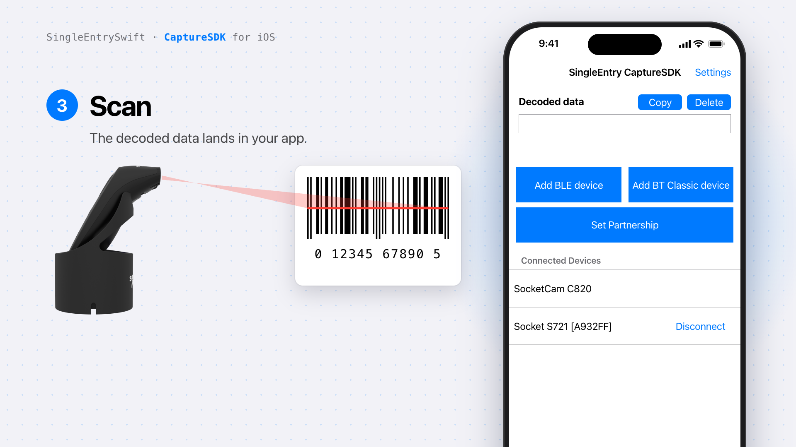
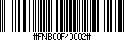

# SingleEntrySwift for iOS

Simple iOS app showing how to use the [`iOS CaptureSDK` Swift Package](https://github.com/SocketMobile/swift-package-capturesdk/releases/tag/2.1.22) to connect Socket Mobile barcode scanners, NFC readers and SocketCam (camera scanning) to an iOS application.


## Prerequisites

- Xcode with an iOS 15.0+ device
- The [Socket Mobile `CaptureSDK` Swift Package](https://github.com/SocketMobile/swift-package-capturesdk) (2.1.22 or later). Xcode resolves it automatically when opening the project.

## Documentation

The `CaptureSDK` [documentation can be found here](https://docs.socketmobile.com/).

## Installation

Clone the project and open `SingleEntrySwift.xcodeproj`.

Your application's `Info.plist` must contain the following keys:

- `LSApplicationQueriesSchemes` (Queried URL Schemes) with the array item `sktcompanion` (in lower case).
- `UISupportedExternalAccessoryProtocols` with the array item `com.socketmobile.chs`. This is required for Bluetooth Classic devices. Adding this protocol requires your application to be whitelisted by Socket Mobile before submission to the App Store. You can submit your app to be whitelisted in the Socket Mobile Developer portal.
- `CFBundleAllowMixedLocalizations` set to `YES`.
- `NSCameraUsageDescription` with a reason to use the camera for SocketCam.
- `NSBluetoothAlwaysUsageDescription` with a reason to use Bluetooth.

Build and run the application on a device to test it with a Socket Mobile device or with SocketCam.

## Screenshots

### Main View

The main view shows:

- the decoded data with the **Copy** and **Delete** buttons,
- the **Add BLE device** and **Add BT Classic device** buttons to discover and connect devices,
- the **Set Partnership** button to configure the Single Partnership feature,
- the list of **Connected Devices** (SocketCam is always listed) and, during a Bluetooth LE discovery, the list of **Discovered Devices**,
- a **Settings** link showing the CaptureSDK version.

Tapping a connected device opens its features: trigger, friendly name, symbologies, battery level / power state and firmware version.



## Description

This sample application shows how to discover, connect and use Socket Mobile devices directly in your own application's flow, without the Socket Mobile Companion app.

We advise you to create some UI to show the discovered devices and the connected devices. Connected devices are remembered by CaptureSDK and reconnect automatically once in the vicinity of your iOS device. To stop a device from reconnecting, you need to remove it (see [Removing a device](#removing-a-device)).

## Project structure

| File | Purpose |
| --- | --- |
| `SingleEntryViewController.swift` | Opens CaptureSDK and displays the decoded data |
| `CaptureSdkHandler.swift` | Implements all the `CaptureHelper` delegates and forwards the events through `NotificationCenter` |
| `DevicesViewController.swift` | Bluetooth LE / Classic discovery, connection and removal of devices |
| `FeaturesViewController.swift` | List of features available for a connected device |
| `PcscViewController.swift` | Switch an NFC reader to coupler mode or back to reader mode |
| `TriggerViewController.swift` | Start, stop and continuous trigger (including SocketCam) |
| `FriendlyNameViewController.swift` | Get / set the device friendly name |
| `SymbologiesViewController.swift` | Get / set barcode symbologies and NFC tag types |
| `BatteryViewController.swift` | Get the battery level and the power state |
| `FirmwareViewController.swift` | Get the firmware version |
| `SinglePartnershipViewController.swift` | Single Partnership feature |
| `CaptureHelperExtension.swift` | Example of a `CaptureHelper` extension |

## CaptureHelper

`CaptureHelper` is part of the `CaptureSDK` package. It wraps the CaptureSDK boilerplate and exposes a simple API through `CaptureHelper.sharedInstance` and `CaptureHelperDevice`.

### Shared instance and delegates

`CaptureHelper.sharedInstance` is shared across the view hierarchy, so there is no need to pass a reference to it between your views.

`CaptureHelper` notifies its delegates through a set of protocols. Adopt only the ones your application needs:

| Protocol | Methods |
| --- | --- |
| `CaptureHelperDevicePresenceDelegate` | `didNotifyArrivalForDevice`, `didNotifyRemovalForDevice` |
| `CaptureHelperDiscoveryDelegate` | `didDiscoverDevice`, `didEndDiscoveryWithResult` |
| `CaptureHelperDeviceDecodedDataDelegate` | `didReceiveDecodedData` |
| `CaptureHelperDevicePowerDelegate` | `didChangePowerState`, `didChangeBatteryLevel` |
| `CaptureHelperDeviceButtonsDelegate` | `didChangeButtonsState` |
| `CaptureHelperErrorDelegate` | `didReceiveError` |
| `CaptureHelperLoggerDelegate` | `didReceiveLogTrace` |
| `CaptureHelperAllDelegate` | All of the above |
| `CaptureHelperPcscDelegate` | `didNotifyArrivalForCoupler`, `didNotifyRemovalForCoupler`, `didNotifyArrivalForTag`, `didNotifyRemovalForTag` |

When a view requiring scanning capabilities becomes active, it calls `pushDelegate` to receive the notifications. When it becomes inactive, it calls `popDelegate` and the previous delegate, if any, receives the notifications again.

The first notification a newly pushed delegate may receive is `didNotifyArrivalForDevice` for each device already connected, even if other delegates already received it.

To keep this sample simple, all the delegates are implemented in a single object, `CaptureSdkHandler`, pushed once. It forwards the events to the views with `NotificationCenter`:

```Swift
class CaptureSdkHandler: NSObject,
                         CaptureHelperDevicePresenceDelegate,
                         CaptureHelperDiscoveryDelegate,
                         CaptureHelperDeviceDecodedDataDelegate,
                         CaptureHelperDevicePowerDelegate,
                         CaptureHelperErrorDelegate,
                         CaptureHelperLoggerDelegate,
                         CaptureHelperPcscDelegate {
    // ...
}
```

### Opening CaptureSDK

`openWithAppInfo` is the first method to call in order to use CaptureSDK. In this sample it is called in `SingleEntryViewController.viewDidLoad`.

The application information must match the information provided during the application registration in the [Socket Mobile Developer portal](https://socketmobile.dev).

```Swift
let appInfo = SKTAppInfo()
appInfo.appKey = "<your AppKey>"
appInfo.appID = "ios:com.mycompany.myapp"
appInfo.developerID = "<your Developer ID>"

let captureHelper = CaptureHelper.sharedInstance
captureHelper.pushDelegate(captureHandler)

// Delegates are called on the main queue, so they can update the UI directly
captureHelper.dispatchQueue = DispatchQueue.main

// Enable the logs before opening CaptureSDK (requires CaptureHelperLoggerDelegate)
captureHelper.setLogger(enable: true)

captureHelper.openWithAppInfo(appInfo) { result in
    print("Result of Capture initialization: \(result.rawValue)")
}
```

This method must be called **only once** in the entire application. The open is asynchronous and its completion handler confirms whether CaptureSDK has been opened successfully.

**NOTE**: It is **NOT** recommended to close CaptureSDK, because this forces CaptureSDK to reinitialize the Socket Mobile devices the next time the application opens it. Closing CaptureSDK does not save power. If a view does not want to receive events anymore, it just calls `popDelegate`.

### SocketCam

SocketCam (camera scanning) is enabled by default. SocketCam C820 and C860 are notified through `didNotifyArrivalForDevice` like any other device, and a scan is started with the trigger (see `TriggerViewController.swift`):

```Swift
device.setTrigger(.start) { result, propertyResult in
    print("setTrigger start: \(result.rawValue)")
}
```

## Devices discovery

**Socket Mobile devices are mainly Bluetooth Classic and are transitioning to Bluetooth Low Energy.** Your customers may still use Bluetooth Classic devices for a while, so think about supporting both discoveries. You can choose which one to launch first.

Both discoveries are started with `CaptureHelper.sharedInstance.addBluetoothDevice`. No device manager is needed.

### Adding a Bluetooth Low Energy device

Start the Bluetooth LE discovery from your own UI or flow, for instance the peripherals settings of your app:

```Swift
CaptureHelper.sharedInstance.addBluetoothDevice(.bluetoothLowEnergy) { result in
    print("addBluetoothDevice - Bluetooth Low Energy: \(result.rawValue)")
}
```

For each discovered device, the `CaptureHelperDiscoveryDelegate` method `didDiscoverDevice` is called. Keep the discovered devices in an array to display them in your own UI:

```Swift
func didDiscoverDevice(_ device: SKTCaptureDiscoveredDeviceInfo) {
    print("didDiscoverDevice: \(device.name ?? "") - \(device.identifierUuid ?? "")")

    if !discoveredDevices.contains(where: { $0.identifierUuid == device.identifierUuid }) {
        discoveredDevices.append(device)
        myDiscoveryTableView.reloadData()
    }
}
```

The discovery ends once its timeout has elapsed and `didEndDiscoveryWithResult` is called:

```Swift
func didEndDiscoveryWithResult(_ result: SKTResult) {
    print("didEndDiscoveryWithResult: \(result.rawValue)")
}
```

### Connecting to a discovered device

To connect to a discovered Bluetooth LE device, call `connectToDiscoveredDevice` on `CaptureHelper`:

```Swift
CaptureHelper.sharedInstance.connectToDiscoveredDevice(selectedDiscoveredDevice) { result in
    print("connectToDiscoveredDevice: \(result.rawValue)")
}
```

Once connected, the device is notified through `didNotifyArrivalForDevice`, which is the place to add it to your list of connected devices.

### Adding a Bluetooth Classic device

```Swift
CaptureHelper.sharedInstance.addBluetoothDevice(.bluetoothClassic) { result in
    print("addBluetoothDevice - Bluetooth Classic: \(result.rawValue)")
}
```

This presents the iOS native picker. Bluetooth Classic devices are paired at the iOS Bluetooth Settings level, so once selected, your application receives `didNotifyArrivalForDevice` directly, provided the device is in **Application Mode**. Scan the following barcode to set it:



### Removing a device

To remove a device and prevent it from reconnecting automatically, call `removeBluetoothDevice` with the device's GUID:

```Swift
if let deviceGuid = device.deviceInfo.guid {
    CaptureHelper.sharedInstance.removeBluetoothDevice(deviceGuid) { result in
        print("removeBluetoothDevice: \(result.rawValue)")
    }
}
```

The device is then notified through `didNotifyRemovalForDevice`.

## Device notifications

### didNotifyArrivalForDevice

`CaptureHelperDevicePresenceDelegate` method called when a device is connected. The device can be SocketCam or any other Socket Mobile device supported by CaptureSDK. Keep the `CaptureHelperDevice` to call its features later (trigger, friendly name, battery level, etc.).

### didNotifyRemovalForDevice

`CaptureHelperDevicePresenceDelegate` method called when a device is no longer available (disconnected or removed).

### didReceiveDecodedData

`CaptureHelperDeviceDecodedDataDelegate` method called when a barcode or an NFC tag has been successfully read:

```Swift
func didReceiveDecodedData(_ decodedData: SKTCaptureDecodedData?, fromDevice device: CaptureHelperDevice, withResult result: SKTResult) {
    if result == .E_NOERROR, let decodedData = decodedData {
        print("Decoded Data: \(decodedData.stringFromDecodedData() ?? "")")
    } else if result == .E_CANCEL {
        // The user cancelled a SocketCam scan
    }
}
```

### didChangeBatteryLevel

`CaptureHelperDevicePowerDelegate` method called when the battery level of a device has changed. Use `SKTHelper.getCurrentLevel(fromBatteryLevel:)` to get the percentage.

### didNotifyArrivalForCoupler

`CaptureHelperPcscDelegate` method called when a PC/SC coupler is available, for instance after switching a connected NFC reader to coupler mode with `switchDeviceToCoupler`. `CaptureHelperPcscDelegate` is not part of `CaptureHelperAllDelegate` and must be adopted explicitly.

### didNotifyRemovalForCoupler

`CaptureHelperPcscDelegate` method called when a PC/SC coupler is no longer available.

### didNotifyArrivalForTag

`CaptureHelperPcscDelegate` method called when an NFC tag is presented to the coupler. Keep the `CaptureHelperDevice` of the tag to exchange data with it (`transmitDataForTagWithCompletionHandler`, `writeDataForTag`).

### didNotifyRemovalForTag

`CaptureHelperPcscDelegate` method called when the NFC tag is removed from the coupler.

## PC/SC

PC/SC lets your application read and write NFC tags directly, using a connected Socket Mobile NFC reader in coupler mode. In this sample, the **PC/SC - Coupler mode** feature is listed for NFC readers (`isNFCReader`) and opens the **PCSC feature** screen (`PcscViewController.swift`), with the **Switch to Coupler mode** and **Switch to Reader mode** buttons.

Once the reader is switched to coupler mode, the coupler is notified through [`didNotifyArrivalForCoupler`](#didnotifyarrivalforcoupler). Each tag presented to it is notified through [`didNotifyArrivalForTag`](#didnotifyarrivalfortag) and listed with the **Read** and **Write** buttons (`TagDeviceCell` in `DevicesViewController.swift`):

```Swift
device.switchDeviceToCoupler { result in
    print("switchDeviceToCoupler: \(result.rawValue)")
}

// Write an NDEF message, starting at page 4 of a Type 2 tag
tag.writeDataForTag(ndefData, startingAtPage: 4) { result, tagResponse in
    print("writeDataForTag: \(result.rawValue)")
}

// Read 16 bytes from page 4 with a READ BINARY APDU
tag.transmitDataForTagWithCompletionHandler(Data([0xFF, 0xB0, 0x00, 0x04, 0x10])) { result, response in
    print("transmitDataForTag: \(result.rawValue)")
}
```

To switch the NFC reader back to reader mode, call `switchDeviceToReader`.

## Single Partnership

The Single Partnership feature makes a Socket Mobile Bluetooth LE device discoverable only by the host it has been partnered with. It is configured with `CaptureHelper`:

```Swift
// Through the Web UI, with or without prompt
CaptureHelper.sharedInstance.setSinglePartnership(.webUI) { result in
    print("setSinglePartnership: \(result.rawValue)")
}

// Or with your own Service UUID
CaptureHelper.sharedInstance.setSinglePartnership(.uuid, uuidString: "<your service UUID>") { result in
    print("setSinglePartnership: \(result.rawValue)")
}

CaptureHelper.sharedInstance.getSinglePartnershipStatus { result, status in
    print("getSinglePartnershipStatus: \(status?.rawValue ?? 0)")
}
```

To reset the Single Partnership of a connected device:

```Swift
device.setResetSinglePartnership { result in
    print("setResetSinglePartnership: \(result.rawValue)")
}
```

## Extending CaptureHelper

If a feature is not exposed by `CaptureHelper` or `CaptureHelperDevice`, create an extension and use `getProperty` / `setProperty` with an `SKTCaptureProperty`. An example is shown in `CaptureHelperExtension.swift`.
